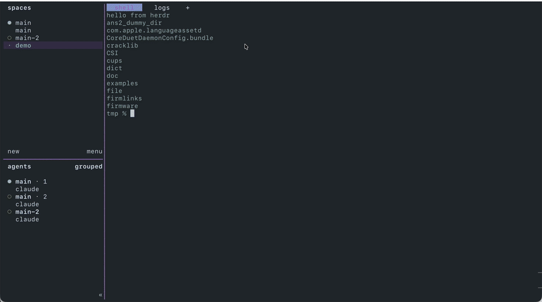

# herdr-web

herdr-web gives [herdr](https://herdr.dev) a web tab. It opens a real Chromium window (Electron) and keeps it floating exactly over one herdr pane. When you switch herdr tabs, zoom another pane or move to another app, the browser hides; when you come back, it shows again in the same place. Every browser can also be driven from scripts over the Chrome DevTools Protocol, so Playwright can click and read pages that you can see in your terminal.

It works on macOS only.



## Requirements

- macOS
- herdr, tested with 0.9.5, on your PATH
- Node.js 20 or newer, on your PATH
- Xcode command line tools, for `swiftc` (`xcode-select --install`)

## Install

```bash
git clone https://github.com/harshagowda/herdr-web.git ~/herdr-web
cd ~/herdr-web
npm install
```

You do not install Electron yourself. It is a normal npm dependency, so `npm install` fetches it into `node_modules/` together with everything else, and builds the small Swift helper `bin/hostwatch`. If the helper is missing later, the CLI builds it again on the next start.

Open a browser in a new herdr tab:

```bash
bin/web https://example.com/
```

The first command starts the app in the background, and the very first start may download the Electron binary, so it can take a minute. The app log goes to `herdr-web.log` in the repo folder.

## herdr keybinding

Add this to `~/.config/herdr/config.toml`, then run `herdr server reload-config`. ctrl+b then i opens a web tab:

```toml
[ui]
prompt_new_tab_name = false

[[keys.command]]
key = "prefix+i"
type = "shell"
command = "~/herdr-web/bin/web"
description = "open a web tab"
```

`prompt_new_tab_name = false` is recommended because herdr opens its tab name prompt in the middle of the screen, and the browser floats on top of it, so you would be typing into a prompt you cannot see.

herdr runs the command with its own environment, so `node` and `herdr` must be on that PATH (or set `HERDR_BIN`). `bin/web` opens Google by default. Set `HERDR_WEB_HOME_URL` to change it.

## CLI

```bash
bin/herdr-web open --pane <pane_id> [--id name] <url>
bin/herdr-web goto [--id name] <url>
bin/herdr-web eval [--id name] <js>
bin/herdr-web screenshot [--id name] --out <file.png>
bin/herdr-web list
bin/herdr-web cdp-url
bin/herdr-web close [--id name]
bin/herdr-web quit
```

Without `--id`, a command acts on the first browser. Pane ids come from `herdr pane list` or `herdr pane layout`.

## Settings

| variable | default | what it does |
|---|---|---|
| `HERDR_BIN` | `herdr` on PATH | the herdr binary |
| `HERDR_WEB_PORT` | 9338 | local HTTP port the CLI talks to |
| `HERDR_WEB_CDP_PORT` | 9339 | DevTools port for Playwright |
| `HERDR_WEB_SLEEP_AFTER_MS` | 60000 | how long a page stays hidden before it sleeps |
| `HERDR_WEB_HOME_URL` | https://www.google.com/ | page `bin/web` opens with no URL |
| `HERDR_SOCKET_PATH` | `~/.config/herdr/herdr.sock` | herdr's event socket |

Both ports listen on 127.0.0.1 only.

## Playwright

```js
const { chromium } = require('playwright-core');

const browser = await chromium.connectOverCDP('http://127.0.0.1:9339');
const page = browser.contexts().flatMap((c) => c.pages())
  .find((p) => !p.url().endsWith('/toolbar.html'));
await page.click('text=More information');
await browser.close(); // disconnects only, the browser stays open
```

Each browser shows up as two pages: the page itself and its URL bar (`toolbar.html`).

`npm test` runs `test/toolbar.js`, which types an address into a URL bar, checks the page followed, and goes back. Open a browser first.

## Memory

- Pages from the same site share one renderer process. This saves memory, but if that renderer crashes, every page of that site goes with it.
- A page that has been hidden for 60 seconds is closed to free its renderer. Its history and scroll position are kept, and it reopens when you show it again or a command uses it. Change the delay with `HERDR_WEB_SLEEP_AFTER_MS`.

## Known limits

- herdr dialogs that open in the centre of the screen sit under a shown browser. Switch to another tab first, or turn off the tab name prompt as above.
- It follows one attached herdr client. With two clients attached, it uses the first one it finds.
- It assumes herdr's default layout: sidebar on the left and tab bar on top.
- Pixel placement assumes a 2x (Retina) display for terminals that report the grid in pixels, such as Ghostty.
- herdr-web reads window positions and the terminal size only. It installs no global keyboard or mouse hooks and needs no Accessibility or Screen Recording permission, by design.

## License

MIT, see LICENSE. Electron is MIT licensed.
